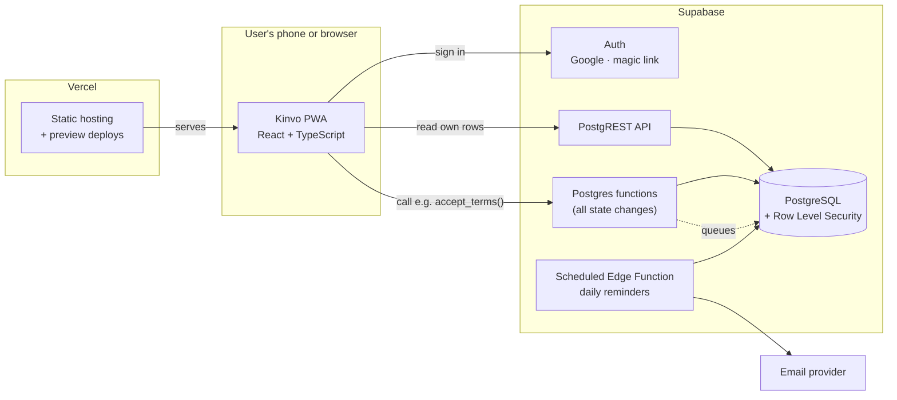
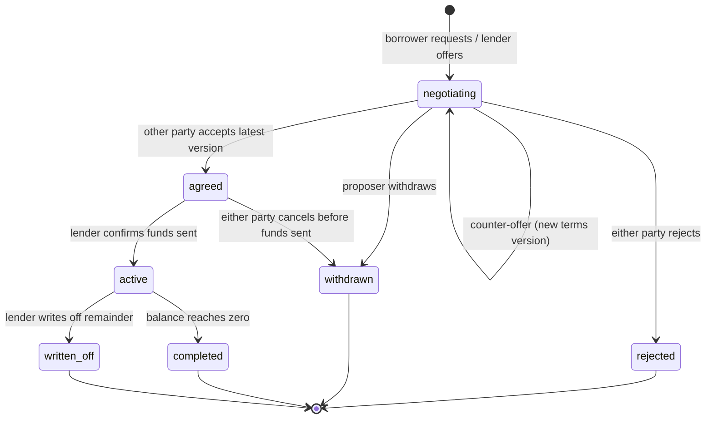

# Architecture

## Overview

Kinvo has three parts:

1. **Web app (PWA).** React + TypeScript. It shows data and collects input. It contains no trusted business logic.
2. **Supabase.** PostgreSQL database, authentication, and scheduled Edge Functions. This is where the rules live.
3. **Email provider.** Sends notifications. It is called only from server-side functions.



## The core rule: reads are direct, writes go through functions

In plain terms: the app may *look* at your data directly, but it may never *change* it directly. Every change is a request to a named database function, such as `record_repayment(...)`. The function checks the request is allowed and valid, makes the change, and writes an audit entry, all in one transaction.

Why:

- **Security.** Row Level Security (RLS) grants `SELECT` on rows you're part of and grants no `INSERT`/`UPDATE`/`DELETE` at all. A modified client still can't change a balance.
- **One source of truth.** Rules like "instalments must add up to the total" live in one place, not duplicated across screens.
- **Audit by construction.** Because every change passes through a function, every change gets logged.

See ADR-0003.

## Layers in the web app

```text
apps/web/src/
├── domain/      Pure TypeScript: money, allocation, schedule maths. No React, no network.
├── data/        Supabase client wrappers. One module per feature (loans, repayments, ...).
├── features/    Screens and components grouped by feature.
└── shared/      UI primitives, formatting, hooks.
```

Dependencies only point downward: `features → data → domain`. The `domain` layer is pure functions, so it's quick to unit test and doesn't depend on anything else.

The same calculations exist in SQL (authoritative) and in `domain/` (for instant previews, like showing the total while someone types). Shared test cases in `tests/fixtures/` run against both to prove they agree.

## Loan state machine



"Overdue" is not a state. An active loan is overdue when any instalment's due date has passed and it isn't fully covered by confirmed payments. It's calculated in a database view, so it can't fall out of date.

## Time and dates

- Due dates are stored as `date` (a calendar day, no time) and interpreted in `Pacific/Auckland`.
- Event timestamps are `timestamptz` (stored in UTC).
- The reminder job runs once a day at a fixed NZ morning time and compares against today's date in `Pacific/Auckland`. This keeps daylight-saving changes from shifting reminders to the wrong day.

## Environments

| Environment | Frontend | Database | Trigger |
|---|---|---|---|
| Local | `vite dev` | Supabase CLI (Docker) | Developer machine |
| Preview | Vercel preview URL | Shared dev Supabase project | Every pull request |
| Production | Vercel production | Production Supabase project | Merge to `main` with CI passing |

Migrations in `supabase/migrations/` are the only way the schema changes. They're applied to production only from `main`.

## Testing strategy

| Level | Tool | What it covers |
|---|---|---|
| Unit | Vitest | `domain/` maths: allocation, schedules, money formatting |
| Database | pgTAP via Supabase CLI | RLS policies (who can see what) and the state-change functions |
| Component | Vitest + Testing Library | Key forms and agreement screen |
| End-to-end | Playwright | Request → counter → accept → fund → repay, happy path |

Database permission tests are the most important tests in the project: they prove one user can't see or change another user's loans.
