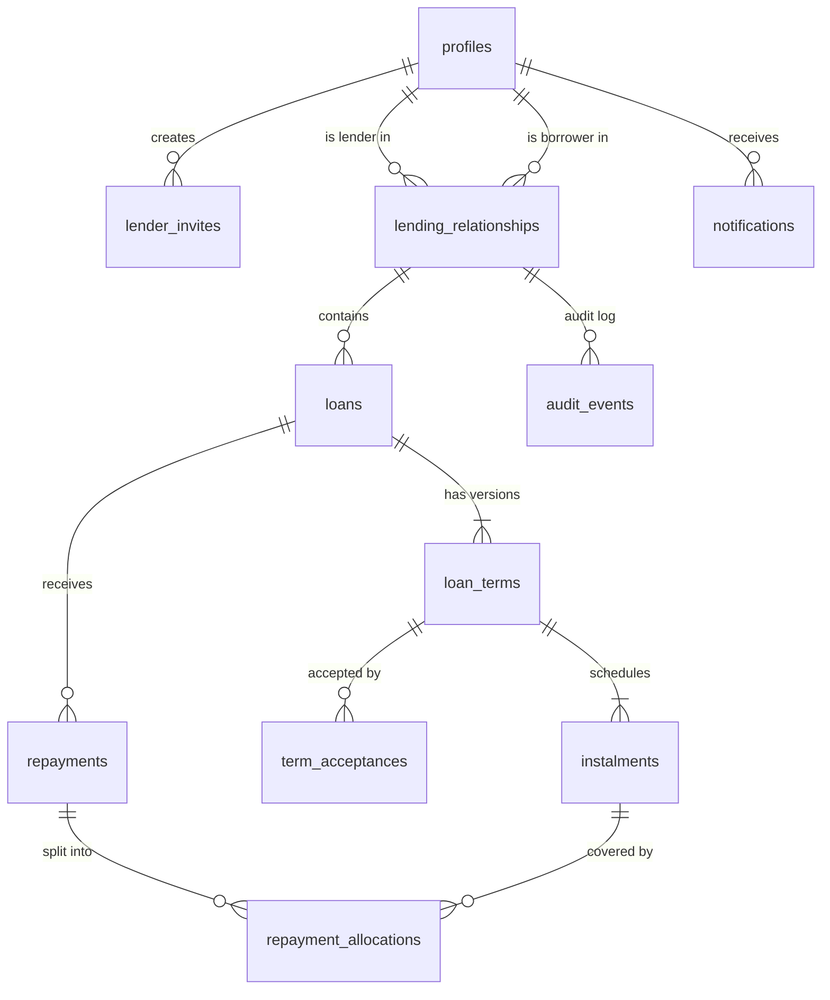

# Database schema

Tables marked **implemented** exist in `supabase/migrations`. The rest are planned for milestones 3–6. Names and columns may change during implementation. If they do, this document is updated in the same pull request.

## Entity relationships

## Tables

All primary keys are `uuid`. All money columns are `bigint` cents with `CHECK (... >= 0)`. All tables have `created_at timestamptz not null default now()`.

### `profiles` (implemented)
One row per signed-in user, created automatically on sign-up from `auth.users`.

| Column | Type | Notes |
|---|---|---|
| id | uuid | PK, FK → `auth.users.id` |
| display_name | text | 1–80 characters, from the Google name or email prefix |
| email | text | Copied from auth for notifications |
| can_lend | boolean | Lender access, granted manually (ADR-0008) |

### `lender_invites` (implemented)
Single-use, 7-day links (ADR-0008).

| Column | Type | Notes |
|---|---|---|
| id | uuid | PK |
| lender_id | uuid | FK → profiles |
| token_hash | text | SHA-256 of the 256-bit token in the link. The raw token is never stored. |
| note | text | Optional label, e.g. "Cousin Sam" |
| expires_at | timestamptz | |
| accepted_by, accepted_at | uuid, timestamptz | Set together when used |
| revoked_at | timestamptz | |

### `lending_relationships` (implemented)
Links one lender to one borrower. Replaces the `family_groups` idea from the brief (see ADR-0006).

| Column | Type | Notes |
|---|---|---|
| id | uuid | PK |
| lender_id | uuid | FK → profiles |
| borrower_id | uuid | FK → profiles |
| invite_id | uuid | The invite that created or last reopened it |
| ended_at | timestamptz | Null while active. Re-inviting reopens the same row. |

Constraints: `UNIQUE (lender_id, borrower_id)`, `CHECK (lender_id <> borrower_id)`.

### `loans`
The "envelope" for one loan. Terms live in `loan_terms`. The brief's separate `loan_requests` table is folded in here: a request is just a loan in the `negotiating` state whose first terms version was proposed by the borrower.

| Column | Type | Notes |
|---|---|---|
| id | uuid | PK |
| relationship_id | uuid | FK → lending_relationships |
| status | loan_status enum | `negotiating`, `agreed`, `active`, `completed`, `rejected`, `withdrawn`, `written_off` |
| reason | text | Borrower's stated reason |
| current_terms_id | uuid | FK → loan_terms, the latest version |
| funds_sent_at | timestamptz | Set when the lender confirms (AG-04) |

### `loan_terms`
Immutable. A counter-offer inserts a new row; nothing is updated.

| Column | Type | Notes |
|---|---|---|
| id | uuid | PK |
| loan_id | uuid | FK → loans |
| version | int | 1, 2, 3... `UNIQUE (loan_id, version)` |
| proposed_by | uuid | FK → profiles |
| principal_cents | bigint | `> 0` |
| charge_cents | bigint | One-off charge, `>= 0` |
| late_terms | text | Plain-language late-payment terms, may be empty |
| conditions | text | Other agreed conditions |
| terms_hash | text | SHA-256 of the canonical terms, used in acceptances |

### `instalments`
| Column | Type | Notes |
|---|---|---|
| id | uuid | PK |
| terms_id | uuid | FK → loan_terms |
| sequence | int | 1, 2, 3... |
| due_on | date | NZ calendar date |
| amount_cents | bigint | `> 0` |

Rule (checked in the proposing function): `sum(amount_cents) = principal_cents + charge_cents`.

### `term_acceptances`
| Column | Type | Notes |
|---|---|---|
| id | uuid | PK |
| terms_id | uuid | FK → loan_terms |
| accepted_by | uuid | FK → profiles |
| terms_hash | text | Must equal `loan_terms.terms_hash` at acceptance time |
| accepted_at | timestamptz | |

`UNIQUE (terms_id, accepted_by)`.

### `repayments`
Never updated except for status transitions, and never deleted.

| Column | Type | Notes |
|---|---|---|
| id | uuid | PK |
| loan_id | uuid | FK → loans |
| amount_cents | bigint | `> 0` |
| received_on | date | |
| method | payment_method enum | `bank_transfer`, `cash`, `other` |
| reference | text | Optional |
| notes | text | Optional |
| status | repayment_status enum | `claimed`, `confirmed`, `disputed`, `reversed` |
| submitted_by | uuid | FK → profiles |
| reverses_id | uuid | FK → repayments, set on a reversing entry |

### `repayment_allocations`
How a confirmed repayment was split. Written by the confirm function using ADR-0004's rules, then never changed.

| Column | Type | Notes |
|---|---|---|
| repayment_id | uuid | FK → repayments |
| instalment_id | uuid | FK → instalments, null for overpayment credit |
| charge_cents | bigint | |
| principal_cents | bigint | |

### `audit_events` (implemented)
Append-only audit log for every state change (NF-03). No client role has `INSERT`, `UPDATE` or `DELETE`. Rows are written only by database functions.

| Column | Type | Notes |
|---|---|---|
| id | bigint | PK, identity |
| actor_id | uuid | FK → profiles, null for system jobs |
| relationship_id | uuid | FK → lending_relationships, null for account-level events |
| event_type | text | e.g. `invite_created`, `invite_accepted`, `relationship_ended` |
| payload | jsonb | Snapshot of what changed |
| occurred_at | timestamptz | |

M3 adds a `loan_id` column so loan events can be filtered per loan.

### `notifications`
Outbox for emails and pushes. Rows are inserted by functions and sent by the scheduled job.

| Column | Type | Notes |
|---|---|---|
| id | uuid | PK |
| recipient_id | uuid | FK → profiles |
| kind | text | e.g. `instalment_due_tomorrow` |
| loan_id | uuid | FK → loans, nullable |
| channel | text | `email`, `push` |
| send_after | timestamptz | |
| sent_at | timestamptz | |

`UNIQUE (recipient_id, kind, loan_id, send_after)` stops duplicate reminders.

## Derived views

| View | Purpose |
|---|---|
| `instalment_status` | Per instalment: amount covered, remaining, `paid` / `due` / `overdue` |
| `loan_balances` | Per loan: total owed, total confirmed paid, outstanding, credit |
| `borrower_history` | Per relationship: loans, totals, on-time rate, average days late |

## Row Level Security summary

| Table | SELECT | INSERT / UPDATE / DELETE |
|---|---|---|
| profiles | Self, and people you share a relationship with | None. Name changes via `set_display_name()` |
| lending_relationships, loans, loan_terms, instalments, term_acceptances, repayments, repayment_allocations | Lender or borrower of the relationship | None. Functions only. |
| audit_events | Your own events, and events in your relationships | None. Functions only. |
| lender_invites | The lender who created it | None. Functions only. |
| notifications | The recipient | None |

## Functions (implemented)

| Function | Who | What it does |
|---|---|---|
| `set_display_name(name)` | Any user | Renames yourself |
| `create_invite(note?)` | Lenders | Returns a new single-use invite token (shown once) |
| `preview_invite(token)` | Any user | Lender's name and invite status, before accepting |
| `accept_invite(token)` | Any user | Creates or reopens a relationship with the lender |
| `revoke_invite(id)` | The lender | Cancels an unused invite |
| `end_relationship(id)` | The lender | Closes a relationship, keeping its history |

Functions raise errors whose message is a stable key (`invite_expired`, `lender_access_required`, …), which the web app maps to friendly text in `data/errors.ts`.
