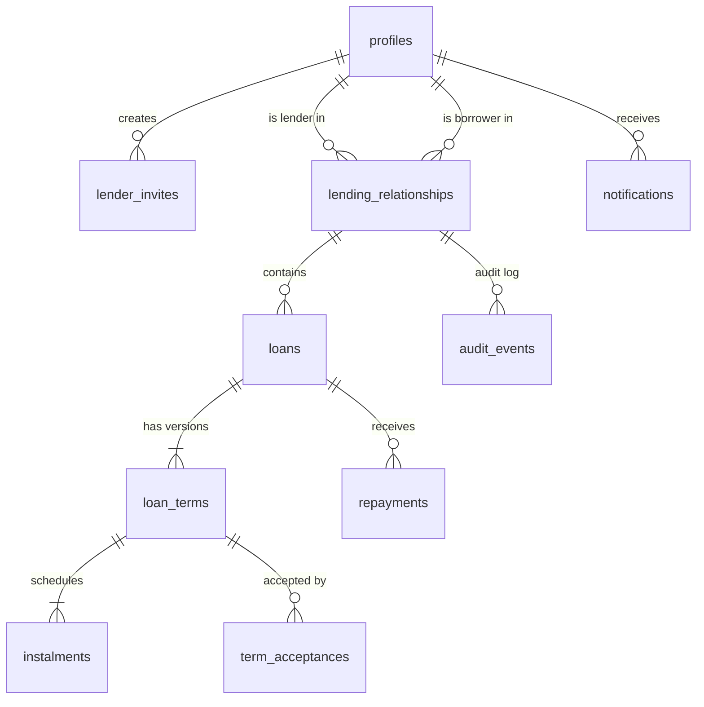

# Database schema

Tables marked **implemented** exist in `supabase/migrations`. `notifications` is planned for M6. Names and columns may change during implementation. If they do, this document is updated in the same pull request.

## Entity relationships

## Tables

All primary keys are `uuid`. All money columns are `bigint` cents with `CHECK (... >= 0)`. All tables have `created_at timestamptz not null default now()`.

### `profiles` (implemented)
One row per signed-in user, created automatically on sign-up from `auth.users`.

| Column | Type | Notes |
|---|---|---|
| id | uuid | PK, FK → `auth.users.id` |
| display_name | text | 1–80 characters, from the Google name or email prefix |
| email | text | Copied from auth for notifications |
| can_lend | boolean | Lender access, granted manually (ADR-0008) |
| email_notifications | boolean | Default true. Off skips notification emails; the in-app list is unaffected |

### `lender_invites` (implemented)
Single-use, 7-day links (ADR-0008).

| Column | Type | Notes |
|---|---|---|
| id | uuid | PK |
| lender_id | uuid | FK → profiles |
| token_hash | text | SHA-256 of the 256-bit token in the link. The raw token is never stored. |
| note | text | Optional label, e.g. "Cousin Sam" |
| expires_at | timestamptz | |
| accepted_by, accepted_at | uuid, timestamptz | Set together when used |
| revoked_at | timestamptz | |
| existing_debt | jsonb | Optional debt from before Kinvo, turned into a loan on acceptance (ADR-0012) |

### `lending_relationships` (implemented)
Links one lender to one borrower. Replaces the `family_groups` idea from the brief (see ADR-0006).

| Column | Type | Notes |
|---|---|---|
| id | uuid | PK |
| lender_id | uuid | FK → profiles |
| borrower_id | uuid | FK → profiles |
| invite_id | uuid | The invite that created or last reopened it |
| ended_at | timestamptz | Null while active. Re-inviting reopens the same row. |

Constraints: `UNIQUE (lender_id, borrower_id)`, `CHECK (lender_id <> borrower_id)`.

### `loans` (implemented)
The "envelope" for one loan. Terms live in `loan_terms`. The brief's separate `loan_requests` table is folded in here: a request is just a loan in the `negotiating` state whose first terms version was proposed by the borrower.

| Column | Type | Notes |
|---|---|---|
| id | uuid | PK |
| relationship_id | uuid | FK → lending_relationships |
| status | loan_status enum | `negotiating`, `agreed`, `active`, `completed`, `rejected`, `withdrawn`, `written_off` |
| reason | text | Borrower's stated reason |
| current_terms_id | uuid | FK → loan_terms, the latest version |
| funds_sent_at | timestamptz | Set when the lender confirms (AG-04) |
| kind | text | `new`, or `existing_debt` for a debt from before Kinvo |
| originally_lent_on | date | For existing debts only |

### `loan_terms` (implemented)
Immutable. A counter-offer inserts a new row; nothing is updated.

| Column | Type | Notes |
|---|---|---|
| id | uuid | PK |
| loan_id | uuid | FK → loans |
| version | int | 1, 2, 3... `UNIQUE (loan_id, version)` |
| proposed_by | uuid | FK → profiles |
| principal_cents | bigint | `> 0` |
| charge_cents | bigint | One-off charge, `>= 0` |
| late_terms | text | Plain-language late-payment terms, may be empty |
| conditions | text | Other agreed conditions |
| terms_hash | text | SHA-256 of the canonical terms, used in acceptances |

### `instalments` (implemented)
| Column | Type | Notes |
|---|---|---|
| id | uuid | PK |
| terms_id | uuid | FK → loan_terms |
| sequence | int | 1, 2, 3... |
| due_on | date | NZ calendar date |
| amount_cents | bigint | `> 0` |

Rule (checked in the proposing function): `sum(amount_cents) = principal_cents + charge_cents`.

### `term_acceptances` (implemented)
| Column | Type | Notes |
|---|---|---|
| id | uuid | PK |
| terms_id | uuid | FK → loan_terms |
| accepted_by | uuid | FK → profiles |
| terms_hash | text | Must equal `loan_terms.terms_hash` at acceptance time |
| accepted_at | timestamptz | |

`UNIQUE (terms_id, accepted_by)`.

### `repayments` (implemented)
Never updated except for status transitions, and never deleted.

| Column | Type | Notes |
|---|---|---|
| id | uuid | PK |
| loan_id | uuid | FK → loans |
| amount_cents | bigint | `> 0` |
| received_on | date | |
| method | payment_method enum | `bank_transfer`, `cash`, `other` |
| reference | text | Optional |
| notes | text | Optional |
| status | repayment_status enum | `claimed`, `confirmed`, `disputed`, `reversed` |
| submitted_by | uuid | FK → profiles |

### Allocation (derived, not stored)
How each payment splits across instalments isn't stored. `private.instalment_progress(loan)` replays confirmed payments in the order received (oldest instalment first, charge before principal), so reversals never leave stale data (ADR-0010).

### `audit_events` (implemented)
Append-only audit log for every state change (NF-03). No client role has `INSERT`, `UPDATE` or `DELETE`. Rows are written only by database functions.

| Column | Type | Notes |
|---|---|---|
| id | bigint | PK, identity |
| actor_id | uuid | FK → profiles, null for system jobs |
| relationship_id | uuid | FK → lending_relationships, null for account-level events |
| event_type | text | e.g. `invite_created`, `invite_accepted`, `relationship_ended` |
| payload | jsonb | Snapshot of what changed |
| occurred_at | timestamptz | |

`loan_id` (FK → loans, nullable) links events to a loan; both parties can see a loan's events.

### `notifications` (implemented)
The in-app list and the email outbox in one (ADR-0013). Rows are written only by the database: a trigger on `audit_events` and the hourly reminder job.

| Column | Type | Notes |
|---|---|---|
| id | uuid | PK |
| recipient_id | uuid | FK → profiles |
| kind | text | e.g. `loan_requested`, `payment_claimed`, `due_tomorrow`, `overdue`, `borrower_overdue` |
| loan_id | uuid | FK → loans, nullable |
| title, body | text | Final wording, used by both the app and the email |
| link_path | text | In-app path, e.g. `/loans/<id>` |
| dedupe_key | text | UNIQUE. `event:<audit id>:<recipient>`, `due_tomorrow:<instalment>`, `overdue:<instalment>:<days late>:<recipient>`, … |
| created_at, read_at | timestamptz | `read_at` is set by `mark_notifications_read()` |
| email_status | text | `pending`, `sending`, `sent`, `failed`, `skipped` (recipient has emails off) |
| email_attempts, email_sent_at, email_last_error | | Retry bookkeeping for the sender |

## Derived views

| View | Purpose |
|---|---|
| `get_instalment_progress(loan)` (function) | Per instalment: amount paid (charge and principal), date fully paid, `paid` / `due` / `overdue` |
| `list_loan_balances()` (function) | Per funded loan: total, paid, written off, outstanding, next due, overdue amount and count |
| `borrower_history` | Per relationship: loans, totals, on-time rate, average days late |

### Dashboard functions (M5)

| Function | Returns |
|---|---|
| `get_dashboard_summary()` | Lending (owed, overdue, total lent, charges received this NZ tax year), borrowing (owed, overdue, next payment), and counts of things waiting on the caller |
| `list_upcoming_instalments(limit)` | Unpaid instalments across the caller's active loans, soonest first, with role, other person and overdue flag |
| `list_borrower_records()` | Lender only: per borrower, loans, money borrowed/repaid/owed/overdue, and on-time statistics (ADR-0011) |

Internally, `private.replay_payments(loan)` reports how each confirmed payment was split across instalments (charge vs principal). `instalment_progress` and the charges-received figure are both built from it.

## Row Level Security summary

| Table | SELECT | INSERT / UPDATE / DELETE |
|---|---|---|
| profiles | Self, and people you share a relationship with | None. Name changes via `set_display_name()` |
| lending_relationships, loans, loan_terms, instalments, term_acceptances, repayments | Lender or borrower of the relationship | None. Functions only. |
| audit_events | Your own events, and events in your relationships | None. Functions only. |
| lender_invites | The lender who created it | None. Functions only. |
| notifications | The recipient | None. `mark_notifications_read()` only |

## Functions (implemented)

| Function | Who | What it does |
|---|---|---|
| `set_display_name(name)` | Any user | Renames yourself |
| `create_invite(note?)` | Lenders | Returns a new single-use invite token (shown once) |
| `preview_invite(token)` | Any user | Lender's name and invite status, before accepting |
| `accept_invite(token)` | Any user | Creates or reopens a relationship with the lender |
| `revoke_invite(id)` | The lender | Cancels an unused invite |
| `end_relationship(id)` | The lender | Closes a relationship, keeping its history |

Functions raise errors whose message is a stable key (`invite_expired`, `lender_access_required`, …), which the web app maps to friendly text in `data/errors.ts`.
| `create_loan(relationship, principal, charge, instalments, reason?, late_terms?, conditions?, message?)` | Either party | Starts a request (borrower) or an offer (lender) as version 1 |
| `counter_offer(loan, expected_terms_id, …terms)` | Either party, while negotiating | Adds a new terms version; fails if `expected_terms_id` isn't current |
| `accept_terms(loan, terms_id, terms_hash)` | The party who didn't propose | Marks the loan agreed; fails if the terms or fingerprint changed (ADR-0009) |
| `reject_terms(loan, note?)` | The party who didn't propose | Ends the negotiation as rejected |
| `withdraw_loan(loan, note?)` | The proposer while negotiating; either party once agreed | Cancels before any money moves |
| `confirm_funds_sent(loan, sent_on, method, reference?)` | The lender, once agreed | Makes the loan active (LN-07, AG-04) |

`instalments` is passed as JSON: `[{"due_on": "2026-11-09", "amount_cents": 15000}, …]`. The database checks that dates aren't in the past (NZ time), are strictly increasing, and that amounts add up to principal + charge.
| `record_repayment(loan, amount, received_on, method, reference?, notes?)` | Either party, active loan | Lender: confirmed. Borrower: claimed. Rejects amounts over the balance, future or pre-loan dates, and duplicates within 2 minutes |
| `confirm_repayment(repayment)` | The lender | Confirms a claim; may complete the loan |
| `dispute_repayment(repayment, reason)` | The lender | Marks a claim as not received |
| `reverse_repayment(repayment, reason)` | The lender | Undoes a confirmed payment; may reopen a completed loan |
| `forgive_remaining(loan, note?)` | The lender, active loan | Writes off the balance; returns the amount |
| `set_email_notifications(enabled)` | Any user | Switches your notification emails on or off |
| `export_my_data()` | Any user | Everything you can see, as one JSON document. Runs under your own RLS, so it can't reveal more than the app does |
| `remove_loan(loan, reason?)` | The lender, any status | Hides the loan everywhere (status `removed`), deletes its alerts, logs `loan_removed` (ADR-0015) |
| `clear_notifications(ids?)` | Any user | Deletes your own alerts (all of them when no ids are given) |
| `mark_notifications_read(ids?)` | Any user | Marks your notifications read (all of them when no ids are given) |
| `claim_notification_emails(limit)` | Server only (`service_role`) | Hands the email sender a batch of pending emails, locked so no two runs send the same one |
| `finish_notification_email(id, ok, error?)` | Server only (`service_role`) | Marks an email sent, or returns it to the queue (failed after 5 attempts) |

Scheduled (pg_cron): `private.queue_reminders()` hourly at :05, and `private.trigger_email_sender()` every 5 minutes, which calls the `send-notifications` Edge Function.
